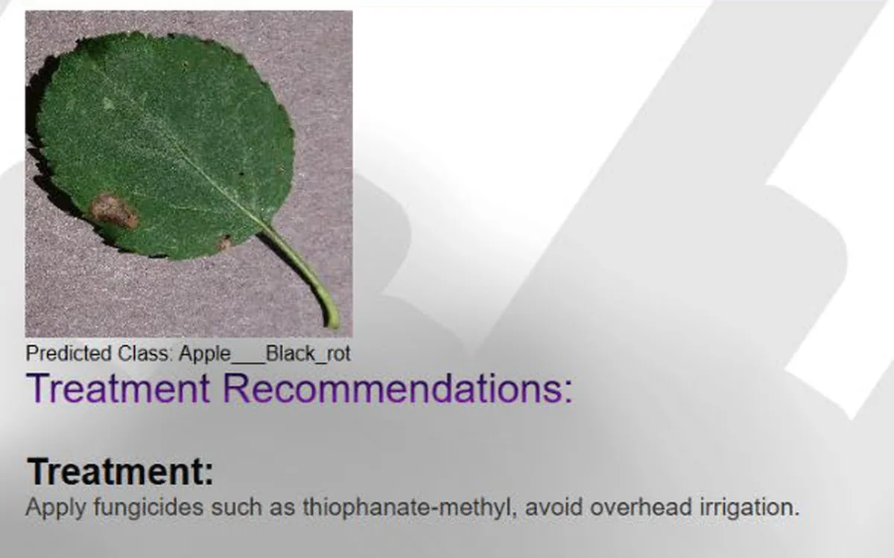
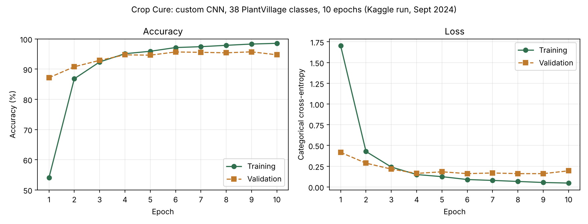

# Crop Cure: Plant Disease Classification

A web app that identifies plant diseases from a photo of a leaf. It recognises 38 classes of healthy and diseased leaves across 14 crops, using a convolutional neural network trained from scratch on the PlantVillage dataset, and suggests a treatment for each diagnosis. The model runs in the browser through TensorFlow.js.

It began as a four-day build for Smart India Hackathon 2024 and was later submitted as a college minor project.

Team of 4 · [Anurag Kushwah](https://www.linkedin.com/in/anurag-kushwaha-929609258/), [Parth Nagar](https://www.linkedin.com/in/parth-nagar-430161273/) and [Yash Chaurasia](https://www.linkedin.com/in/yashchaurasia01/)

Live app: [crop-cure-livid.vercel.app](https://crop-cure-livid.vercel.app/)



## How it works

1. The user uploads a leaf photo in the web app.
2. The image is resized to 256 × 256 and passed to the model in the browser. Nothing is uploaded to a server.
3. The model returns a probability for each of the 38 classes, and the app shows the most likely one.
4. The app shows a suggested treatment for that class. The treatments come from the team's treatment table, `data/disease_treatment.csv`; the web app carries its own copy, with shorter wording, inside its script.

## Model

A convolutional neural network built and trained from scratch in TensorFlow/Keras, with no pretrained backbone:

- Five convolutional blocks of 32, 64, 128, 256 and 512 filters, each with two 3 × 3 `Conv2D` layers followed by max pooling
- Dropout (0.25), then a 1,500-unit dense layer, dropout (0.4) and a 38-way softmax output
- 32,418,762 parameters, all trainable
- Input 256 × 256 RGB, Adam optimiser at learning rate 0.0001, categorical cross-entropy, batch size 32, 10 epochs
- Trained on a Kaggle Tesla T4 GPU in about 43 minutes

## Data

[PlantVillage](https://www.kaggle.com/datasets/mohitsingh1804/plantvillage): 54,305 leaf images in 38 classes, split into 43,444 training and 10,861 validation images.

Crops covered: apple, blueberry, cherry, corn, grape, orange, peach, bell pepper, potato, raspberry, soybean, squash, strawberry and tomato.

## Results

| Metric | Value |
|---|---|
| Training accuracy | 98.80% |
| Validation accuracy | 94.74% |



Both numbers come from `model.evaluate` in the notebook, on the run that produced the saved model. The epoch-by-epoch values are in `results/training_log.csv`.

PlantVillage photos are taken in controlled conditions, one leaf against a plain background, so accuracy on real field photos would be lower. The model hasn't been tested on field images.

## Repository layout

```
notebook/crop_disease_cnn.ipynb   Training, evaluation and single-image prediction, with the outputs from the Kaggle run
data/disease_treatment.csv        Treatment suggestion for each of the 38 classes
results/training_curves.png       Accuracy and loss per epoch
results/training_log.csv          The same values as a table
docs/web-app.webp                 Screenshot of the web app
```

The trained model (`trained_plant_disease_model.h5`, 389 MB) is too large for the repository. It is attached to the [v1.0 release](../../releases).

## Running the notebook

The notebook was written for Kaggle, and its paths point to `/kaggle/input/...`. To re-run it, open it in a Kaggle notebook with a GPU, attach the PlantVillage dataset linked above, and upload `data/disease_treatment.csv` as a dataset. Then update the paths in the cells that read them.

To use the trained model without retraining, download the `.h5` file from the release and load it with `tf.keras.models.load_model`. Pass images as 256 × 256 RGB arrays with pixel values from 0 to 255. The model was trained without rescaling, so don't divide by 255.

## Related repositories

- [YashChaurasia01/CropCure](https://github.com/YashChaurasia01/CropCure): the web app behind the live link, with the TensorFlow.js version of the model
- [YashChaurasia01/CropCureHome](https://github.com/YashChaurasia01/CropCureHome): the project's landing page, at [cropcure-home.vercel.app](https://cropcure-home.vercel.app/)
- [parthnagar1011/CropCure](https://github.com/parthnagar1011/CropCure): an archive of the notebook, both front ends and a screen-recorded demo

The landing page also describes weather forecasts and fertiliser and irrigation scheduling. Those were planned during the hackathon and were never built.
